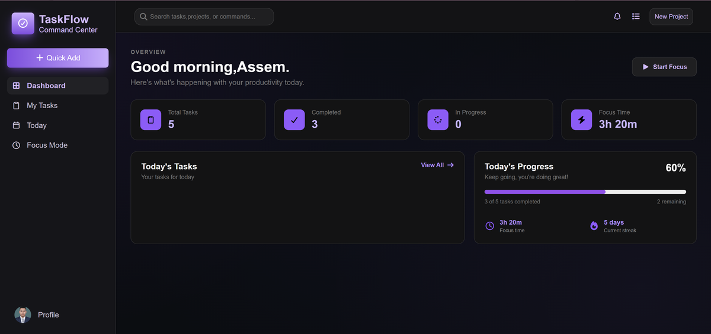
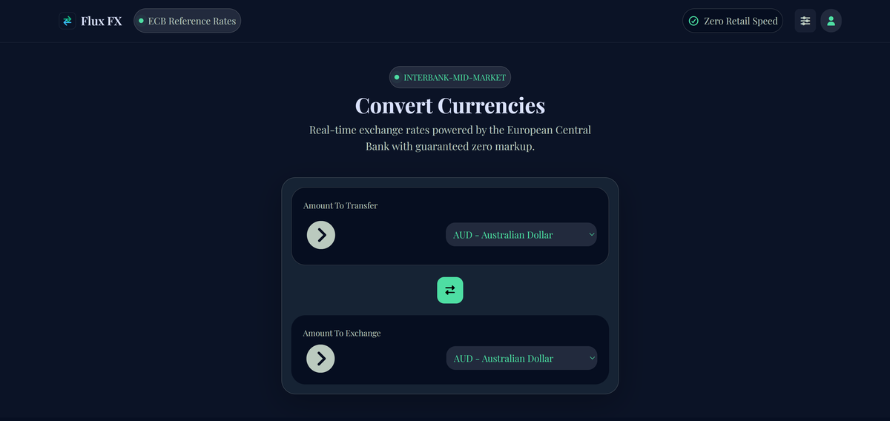
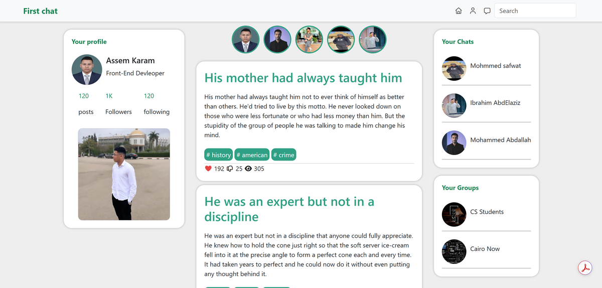
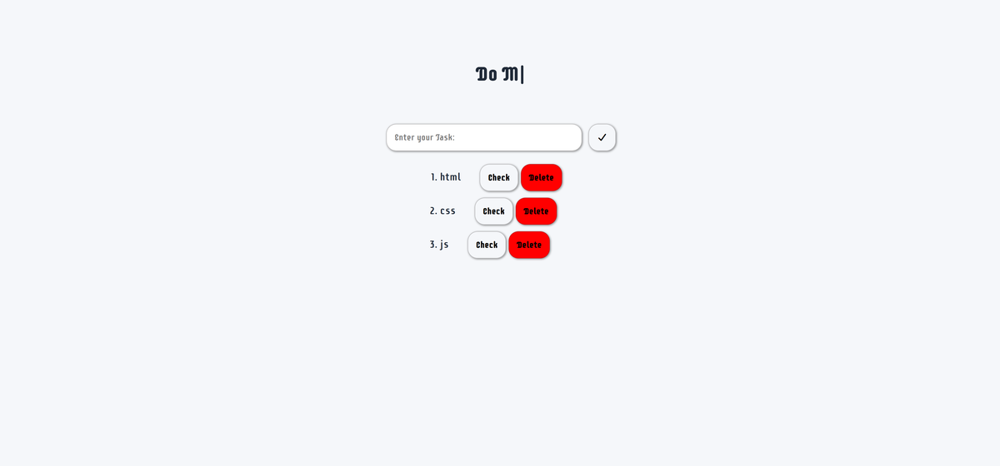
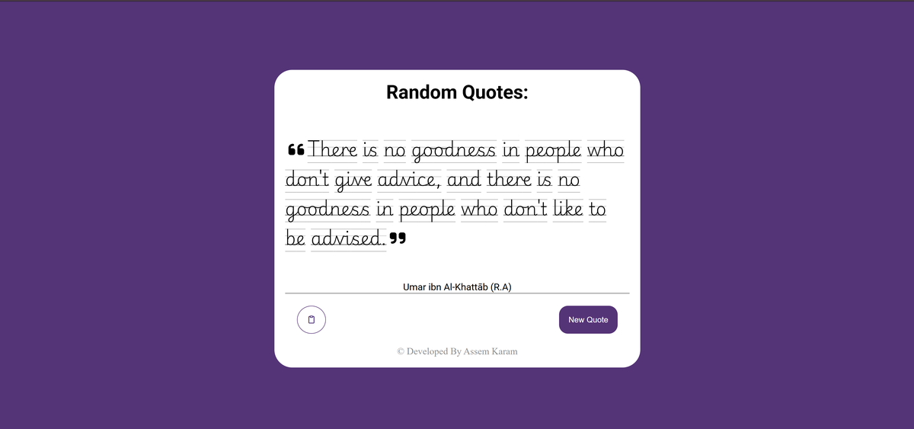
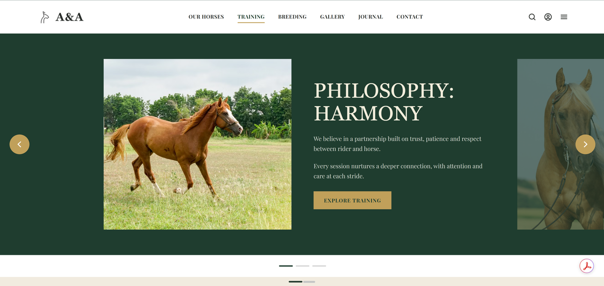

<div align="center">


<br/>


<br/><br/>

<a href="https://assem-karam-portfolio.vercel.app/">
  
</a>
<a href="https://www.linkedin.com/in/assemkaram">
  
</a>
<a href="https://drive.google.com/drive/folders/1y4XgSw_5BSIILB7dgsxvUgwScTQC2Nq9?usp=sharing">
  
</a>
<a href="https://linktr.ee/AsssemKaram">
  
</a>
<a href="https://github.com/assemkaram">
  
</a>

<br/><br/>


</div>

---

## 👨‍💻 About Me

I'm **Assem Karam**, a Computer Science student and Front-End Developer passionate about building modern, responsive, and user-friendly web applications.

- 💻 Focused on Front-End Development.
- ⚛️ Currently exploring React and modern web technologies.
- 🎨 Interested in UI implementation and responsive design.
- 🚀 Building practical projects to improve my development skills.
- 🤝 Open to freelance projects, internships, and collaboration.
- 🌱 Always learning and improving.

```javascript
const assem = {
  name: "Assem Karam",
  role: "Front-End Developer",
  location: "Egypt",
  education: "Computer Science & AI",
  skills: [
    "HTML",
    "CSS",
    "JavaScript",
    "Bootstrap",
    "Tailwind CSS",
    "React"
  ],
  tools: ["Git", "GitHub", "VS Code"],
  currentlyLearning: ["React", "Advanced JavaScript"],
  goal: "Build meaningful digital experiences"
};
```

---

## 🛠️ Tech Stack

<div align="center">

### Frontend Development


### Tools & Workflow


</div>

| Category | Technologies |
|---|---|
| Languages | HTML5, CSS3, JavaScript |
| Frontend | React, Bootstrap, Tailwind CSS |
| Concepts | Responsive Design, UI Implementation, API Integration |
| Tools | Git, GitHub, VS Code |

---

## 🚀 Featured Projects

<div align="center">

<table>
<tr>
<td width="50%" valign="top">

### 📋 TaskFlow

<a href="https://assemkaram.github.io/TaskFlow/">
  
</a>

A productivity management application for organizing tasks and daily activities.

**Highlights:**
- Task management and dashboard
- Multiple views and task filters
- Focus mode and productivity features

[Live Demo](https://assemkaram.github.io/TaskFlow/)

</td>
<td width="50%" valign="top">

### 💱 Flux FX

<a href="https://assemkaram.github.io/Flux-FX/">
  
</a>

A currency converter application with real-time exchange rates.

**Highlights:**
- Currency conversion
- API integration
- Responsive interface

[Live Demo](https://assemkaram.github.io/Flux-FX/)

</td>
</tr>
<tr>
<td width="50%" valign="top">

### 💬 First Chat

<a href="https://assemkaram.github.io/First-Chat/">
  
</a>

A responsive web project built using HTML, CSS, JavaScript, and Bootstrap.

**Highlights:**
- Responsive chat-style interface
- Built with Bootstrap

[Live Demo](https://assemkaram.github.io/First-Chat/)

</td>
<td width="50%" valign="top">

### ✅ To-Do App

<a href="https://assemkaram.github.io/To-Do/">
  
</a>

A JavaScript task management application.

**Highlights:**
- Add and manage daily tasks
- Built with vanilla JavaScript

[Live Demo](https://assemkaram.github.io/To-Do/)

</td>
</tr>
<tr>
<td width="50%" valign="top">

### 🎲 Random Quotes

<a href="https://assemkaram.github.io/Random-Quotes/">
  
</a>

A simple application that displays random quotes.

**Highlights:**
- Random quote generator
- Clean, minimal interface

[Live Demo](https://assemkaram.github.io/Random-Quotes/)

</td>
<td width="50%" valign="top">

### 🐎 A&A

<a href="https://github.com/assemkaram/A-A">
  
</a>

A website for an equestrian brand showcasing horses, training, and breeding.

**Highlights:**
- Pages for horses, training, breeding, gallery, journal, and contact
- Hero slider with a clean, elegant green design

[View Repository](https://github.com/assemkaram/A-A)

</td>
</tr>
</table>

</div>

---

## 📈 Contribution Activity

<div align="center">

### Contribution Calendar


<br/><br/>

### Activity Graph


<br/><br/>


<br/><br/>


</div>

---

## 📊 GitHub Statistics

<div align="center">


</div>

---

## 🎓 Education & Learning

- **Fayoum University** — Faculty of Computers and Artificial Intelligence.
- **NTI** — Web Design Training.
- **DEPI** — Front-End React Development.
- **Rowad Misr** — React Development & Soft Skills.

---

## 🌐 Connect With Me

<div align="center">

<a href="https://assem-karam-portfolio.vercel.app/">
  
</a>
<a href="https://www.linkedin.com/in/assemkaram">
  
</a>
<a href="https://drive.google.com/drive/folders/1y4XgSw_5BSIILB7dgsxvUgwScTQC2Nq9?usp=sharing">
  
</a>
<a href="https://linktr.ee/AsssemKaram">
  
</a>
<a href="https://github.com/assemkaram">
  
</a>

</div>

---

<div align="center">

### ✨ Thanks for visiting my profile!

*Always learning, building, and improving.*


</div>
